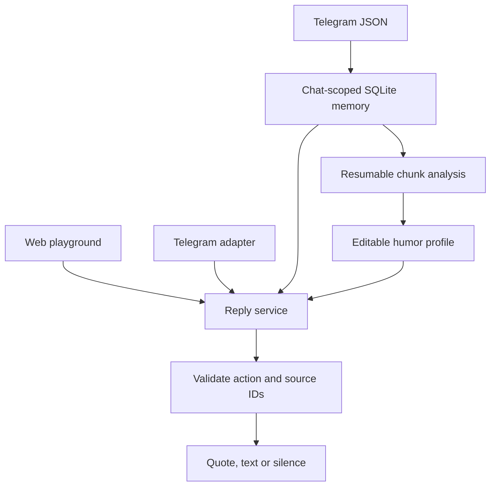

# Architecture decisions

## System shape

One local web server owns the database, credentials and provider calls. A browser imports and reviews memories; an optional Telegram worker uses the same reply service. There is no separate generated codebase for every chat. Each custom bot is a profile plus an isolated memory namespace and Telegram binding.

## ADR 001: Python monolith, static frontend

FastAPI + SQLite + a static same-origin interface avoids two package managers, a hosted database and a queue service. `uv` is present on the host. Keep Python code compatible with 3.12+; resolve actual package compatibility on the host before claiming setup success. SQLite FTS5 provides initial Unicode lexical retrieval. Semantic embeddings may improve paraphrase retrieval later, but a separate vector system is not needed for the first attributable-quote demo.

## ADR 002: Store the archive, summarize its culture

An instruction file is a compact description of style, not a substitute for the original memory. Keep exact normalized messages and context in SQLite. Aggregate style and memes into a versioned profile. Each inference carries evidence IDs, a count of distinct supporting contexts and uncertainty. Repetition and emoji reactions are evidence, not proof of every member's preference.

Process ordered text in bounded chunks. Use overlap for context but count analyzed source messages once. Mark unsupported media separately. Keep a durable job and chunk ledger so cancellation, quota failure or process restart cannot falsely mark a partial archive as analyzed. Do not promise unlimited exports: expose an upload size bound, reject larger inputs clearly, and avoid expanding untrusted archives.

## ADR 003: Deterministic provenance boundary

`quote` actions contain an existing candidate ID, not model-generated quote text. The server performs a second chat-scoped lookup, obtains the exact text and attribution and constructs the outgoing payload. Candidate IDs from another chat or unknown IDs are invalid. A private reply cannot be sent to a different bound group. Never fall back to the first available profile.

## ADR 004: Analysis/generation providers are replaceable

Typed async provider interface: analyze one chunk, merge findings, decide one reply. Gemini implementation uses the server credential and configurable model ID. Offline tests supply a fake provider. The production UI never silently substitutes the fake when Gemini fails. Quote-only search remains usable without AI. Persist call counts and sanitised error categories; avoid logging prompts, headers, exported histories or keys.

Official references checked during planning (2026-10-25 local date):

- https://ai.google.dev/gemini-api/docs/models
- https://ai.google.dev/gemini-api/docs/structured-output
- https://core.telegram.org/bots/api
- https://core.telegram.org/bots/faq
- https://telegram.org/blog/export-and-more
- https://github.com/challengepost/learn-ai-basics

These references guided implementation. The real-history run subsequently persisted 559 chunk findings and 158 intermediate merges, but final synthesis failed with `envelope_exceeded`; see `../orchestration/STATUS.md` for current evidence and limits. A real Telegram round trip remains unverified.

## ADR 005: Start with invocation, add timing later

Manual playground requests and Telegram `/quote`, `/reply`, `/humor` or explicit bot mentions/replies are the first live triggers. Validate the real bot username obtained through `getMe`, parse Telegram entities/command addressing, and distinguish replying to this bot from replying to another participant. Group allowlist, explicit profile binding, update deduplication and per-group cooldown are server checks. Generated humor should not automatically react to every message.

## ADR 006: Sticker IDs are transport assets

Telegram export filenames are not Bot API file IDs. A bot's observed `file_id` is usable by that bot; `file_unique_id` identifies an asset but cannot be sent by itself. Never assume a file ID is portable across custom bot tokens. The initial catalog can learn sticker metadata from imports and register valid transport IDs when this bot receives a sticker. Disable sending a catalog entry until that bot has a valid file ID. Filesystem paths from exports must never be opened outside an approved import root; the first JSON-only importer stores paths as metadata only.

## ADR 007: Local secrets and explicit external actions

The user supplied a Gemini credential for this project. It stays in a mode-0600 local `.env` excluded from Git and public deliverables. The owner subsequently authorized including the existing `.env` in a private team handoff archive; see `handoff.md`. Agys must not read it into prompts, dump the environment, print tokens or embed credentials in source. The application reads it at runtime. Real chat analysis is a visible action; users see the scope and budget before the archive is sent to the configured provider. Uploads, quotes and profiles are not shared across chats. The public repository receives only synthetic fixtures.

No Telegram posting, public deployment, account linking, repository creation or messages to teammates are authorized by a general local implementation task. The user later explicitly authorized the bounded Task 04 Gemini run and a separate Telegram test group; final synthesis and Telegram round trip remain incomplete. This documentation handoff makes no new external calls or posts.

## ADR 008: Review boundaries

The coding agent implements bounded slices. Codex reviews changed code, runs checks independently, and issues a specific repair task if needed. Reports must distinguish code present, offline tests passed, live API verified, Telegram verified and UI verified. Never compress all of these into "works".

## Handoff snapshot: Task 04

Migration v7 persists chunk size and overlap with the durable plan. Bounded async pools now process chunks and independent merge nodes; concurrency does not implement RPM/TPM pacing. The current large corpus completed all chunks but cannot reduce the last four findings within the merge envelope. Add compaction and compatible checkpoint-preserving recovery before rerunning; preserve evidence, job ownership and lifetime charges. Code present, local probes, live partial analysis and end-to-end acceptance remain separate facts. See `../TODO.md`.

The active coding agent later resumed the same job using more compact merge instructions; at the 05:35 Europe/Kyiv handoff snapshot it was running with 737/1000 attempts and no final profile. Upper-level merge caches changed during recovery. The normal envelope-error resume prohibition remains in code; the new path and final outcome still need verification.
